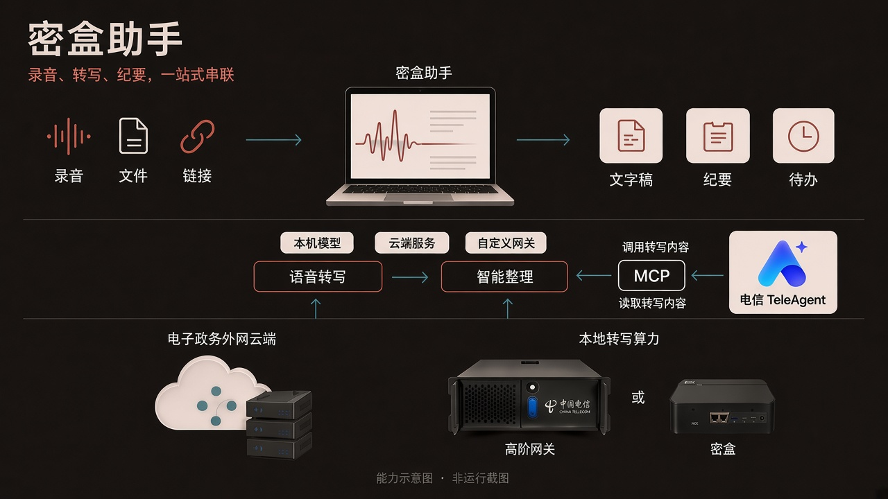
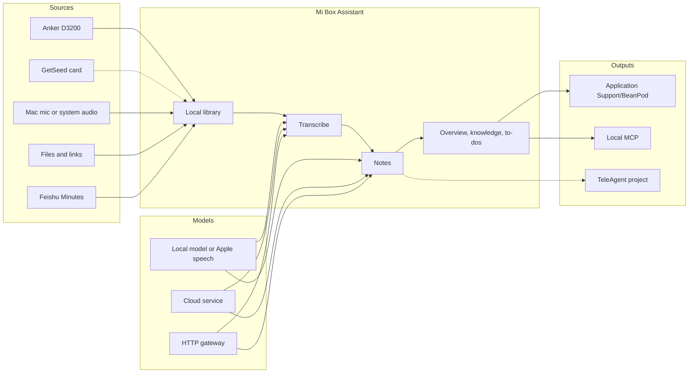
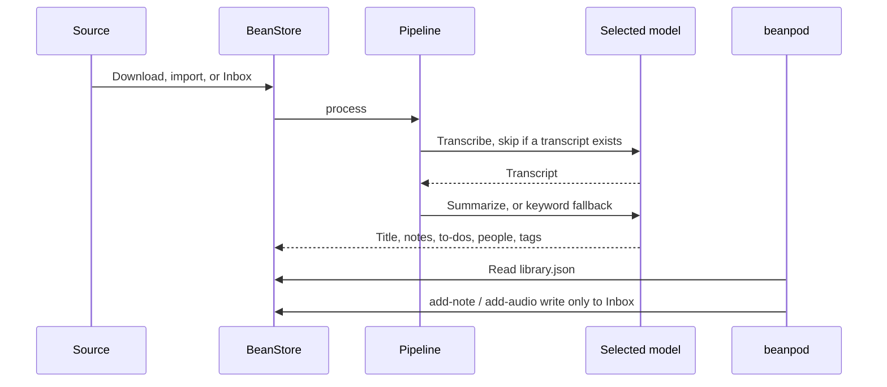
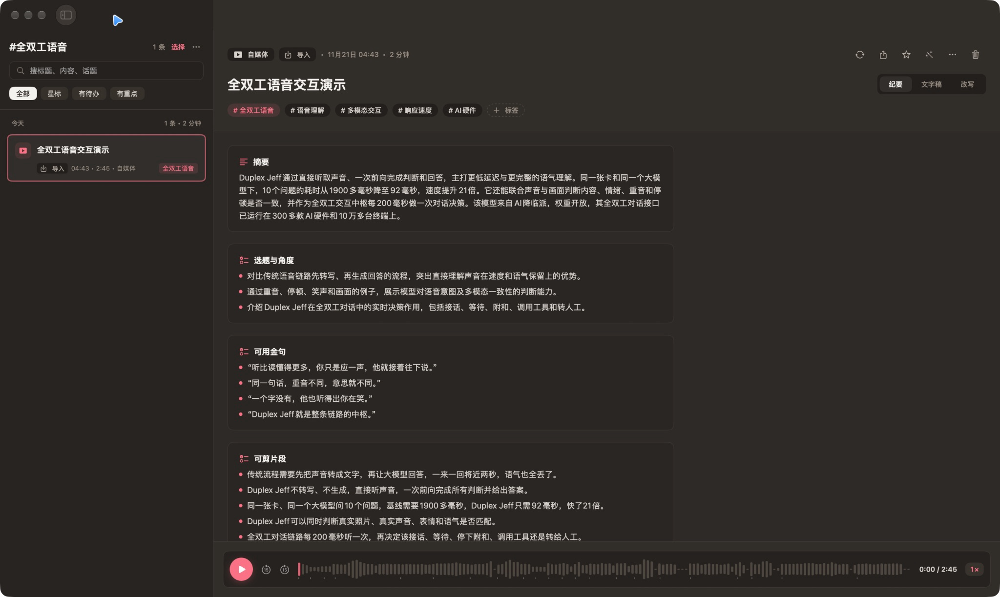
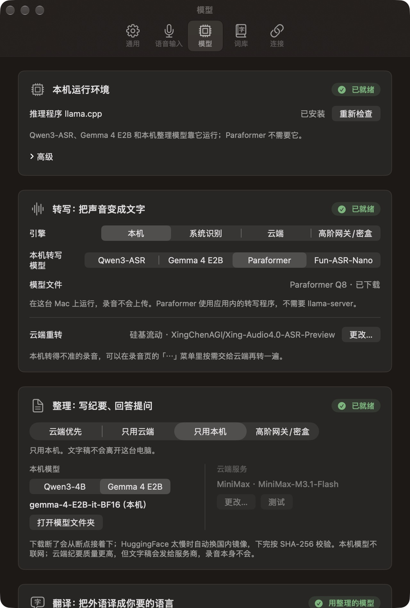

# Mi Box Assistant (based on BeanPod)

[简体中文](README.md) | **English**

[](#quick-start) [](LICENSE)

Mi Box Assistant ties recording, transcription, and notes together: recordings go into a local library, and you can query them in the app or through MCP. Local models, system speech recognition, cloud services, and a user-supplied HTTP gateway are separate choices. Audio or text leaves the computer only on the paths you enable.



This is an AI-generated capability diagram stacked in layers, not a screenshot of the running app. The same Chinese artwork is used here, and it is labeled as a diagram. Its subtitle is “录音、转写、纪要，一站式串联” (recording, transcription, and notes, linked in one place). The picture does not say which operating systems are supported. The top band is recordings, files, and links, plus the transcript, notes, and to-dos. The middle band is transcription and notes. The bottom band draws transcription compute as an e-government extranet cloud, or as a local rack gateway and a Mi Box about the size of a TV box. Those links are optional configuration sketches, not a verified network deployment, and the picture states no bandwidth or certification figures. In the app, the matching control is an OpenAI-compatible URL you fill in. It is not locked to one chassis, and it is not the D3200 recorder. China Telecom TeleAgent is drawn on its own: it reads the transcript through MCP. It does not provide transcription compute, and MCP is not the TeleAgent brand.

## Promo video

Preview build: some transition shots are still to be updated. The motion image is only about the first 2.5 seconds of the new file. Click it, or the link below, to open the full MP4. This page does not autoplay.

[](docs/media/mibox-assistant-promo.mp4)

[Play the full video (MP4, 1280×720, about 102 seconds)](docs/media/mibox-assistant-promo.mp4)

This tree is a derivative of upstream [BeanPod](https://github.com/andyhuo520/beanpod). Acknowledgements and the [MIT](LICENSE) license stay. The extra code here selects among local transcription models (including FunASR), adds the HTTP gateway, and hands a talking-head project to TeleAgent. Upstream DMGs (v0.1.0 and v0.1.1) do not contain those changes. This fork has no GitHub Release.

Three names:

| Name | Meaning |
|---|---|
| Mi Box Assistant | This Mac app. The Chinese product name is 密盒助手 |
| 密盒 as a recording source | The UI label for the Anker soundcore recorder, model D3200. The link is still the recorder protocol |
| 密盒 in the homepage diagram | The small square box: a sketch of local inference hardware. The app has no driver for one specific chassis |
| 高阶网关 in the diagram | The rack: another sketch of local compute, not a verified deployment |
| 高阶网关/密盒 in Settings | An OpenAI-compatible HTTP URL you enter for transcription or notes. It is not limited to one model of hardware, and it is not the D3200 |

The Mac target in `project.yml` is marketing version **0.1.9 (build 10)**. That is the version in this source tree, not the build already installed on a Mac. Read the version inside the installed app.

Unofficial project, not affiliated with the device maker. It is for managing your own recordings. Names and trademarks belong to their owners. Report rights complaints to the upstream [issues](https://github.com/andyhuo520/beanpod/issues). Issues are disabled on this fork.

## What it is for

People who want meeting, interview, podcast, and personal recordings organized on a Mac; people who already have a D3200; people who want Claude, Codex, OpenClaw, TeleAgent, or a URL-only assistant to read the local library. Without the recorder you can still record on the Mac, import files, or paste links.

The iPhone app in `Mobile/` is experimental. It has no on-device large models and no gateway option.

## Features

“In source” means the path exists in this tree. Except for the promo file’s metadata, HTTP checks of links, and Python syntax checks, none of these rows were re-run on a device or in the app while rewriting this document.

| Capability | In source | Where data goes |
|---|---|---|
| D3200: battery, storage, firmware, start/pause/stop from the Mac, follow the device button, highlight marks | Implemented. Protocol notes record checks on firmware 04.92 | Download, then decrypt to `.ogg` on this Mac |
| Auto-download missing recordings on connect | Implemented, can be turned off | Local library |
| Wi‑Fi fast transfer | Implemented. The notes record one run around 500 KB/s and about 40 s off the previous Wi‑Fi. Not a guaranteed rate | Through the recorder’s hotspot. The Mac leaves its previous network during the transfer |
| GetSeed card GSC10 | Written from the public protocol. The repo says it is not tested on hardware. No remote start, no Wi‑Fi transfer | Same library |
| Mac recording | Mic, system audio, or both | Stays local |
| Import audio, video, text, or podcast/video links | Implemented. Link import downloads from the site | Saved locally. Only for public material you may use |
| Video picture | Implemented. Default keeps up to 720p under about 5 minutes; longer items keep audio unless you choose otherwise | Local files |
| Local transcription | Qwen3-ASR 0.6B, Gemma 4 E2B BF16, FunASR Paraformer Q8, Fun-ASR-Nano-2512 | On this Mac. See the fallback below |
| Apple speech recognition | Implemented. The usage string says on-device | This rewrite did not verify whether Apple speech contacts the network |
| Cloud transcription | Optional. Presets include Xiaomi MiMo, SiliconFlow, OpenAI, and Groq, or any `/audio/transcriptions`-compatible URL | **Audio is sent to the service you set** |
| Gateway transcription | Optional HTTP(S) URL, model name, optional key | **Audio is sent to that URL**, LAN or public |
| Live captions | On the recording stage, only after a local model is ready | Current local transcriber |
| Notes | Ten scenes; title, summary, sections, to-dos, people, tags. Professions are a fixed list | Depends on the summary mode below |
| Rewrite | Talking script, short-video script, long post, article, follow-up email, teardown, imitation, custom | Uses the summary model. Long local jobs are chunked first |
| English study mode | Optional for mostly English recordings: CEFR, words, phrases, hard sentences. Off means normal notes | Uses the summary model |
| Knowledge base, projects, tags, Markdown / M4A / WAV export | Implemented | Answers send excerpts to the summary model. Export goes where you choose |
| Recently deleted | Kept 7 days for deletes on this Mac. Device deletes do not | Local |
| Dictation | Implemented, off by default. Requires a connected device and a keyboard modifier | Local model. Audio kept 30 days by default |
| Feishu Minutes | Implemented. Auto sync every 30 minutes | Pulled with your authorized `lark-cli` |
| MCP / CLI | Six tools over stdio, plus HTTP on `127.0.0.1:8791` only | Local. What the assistant does next is up to that assistant |
| Talking-head video | Hands a project to TeleAgent. This app does not render the video | Generation is on Renoise after you confirm. The first use of a sample presenter uploads its photo to your Renoise account |
| iPhone | Experimental `Mobile/` target | Cloud or Apple speech only |

Local-model fallback: the default engine is the local model. If Qwen or Gemma is not downloaded yet, the transcription step uses Apple speech recognition instead. Paraformer and Fun-ASR-Nano fail if weights or the bundled runtime are missing; they do not silently switch. The Settings line that says audio is not uploaded applies only when local transcription is selected and ready. It does not cover cloud, gateway, or summary.

## Quick start

You need a Mac on **macOS 26**. The deployment target in `project.yml` is macOS 26.0. Apple silicon is the practical choice for local models. The bundled FunASR helpers are **macOS arm64** (`ThirdParty/FunASR/PROVENANCE.md`). They are not a usable transcriber on Intel.

This fork publishes no downloadable build. Build this tree. Do not install upstream `BeanPod-0.1.x.dmg` and expect these changes.

The commands below were checked against the repo: Homebrew formulae `xcodegen`, `llama.cpp`, `ffmpeg`, and `yt-dlp` exist on formulae.brew.sh, and both Python scripts parse. The check ran on Linux, with no Swift, Xcode, or XcodeGen. **Nothing was compiled, `swift test` was not run, the app was not opened, and no device was connected.** This is not a passing install log.

### Build from source

Install an Xcode that includes the macOS 26 SDK, and install [Homebrew](https://brew.sh). This rewrite did not confirm a specific Xcode version on a Mac.

```bash
brew install xcodegen llama.cpp ffmpeg
```

Link import also wants `brew install yt-dlp`. Downloaders for Xiaohongshu, Douyin, and WeChat Channels are installed by the app on first use. That path was not run here.

```bash
xcodegen generate
xcodebuild -project BeanPod.xcodeproj -scheme BeanPod -derivedDataPath build build \
  CODE_SIGN_IDENTITY="Apple Development" CODE_SIGN_STYLE=Automatic DEVELOPMENT_TEAM=<your Team ID>
cp -R build/Build/Products/Debug/BeanPod.app /Applications/
open /Applications/BeanPod.app
```

The bundle name is `BeanPod.app`. The display name is 密盒助手. Sign with your Apple Development certificate so Bluetooth permission survives rebuilds; a free Apple ID works. The Team ID is in Xcode → Settings → Accounts. An unsigned build can compile, but macOS may ask for Bluetooth again after every rebuild. Open the app from Applications or Finder. Do not launch the executable inside the bundle from Terminal.

Onboarding runs on first launch. The app copies its CLI to `~/.local/bin/beanpod`. If `llama-server` is missing, Settings → Models can install it. The lookup list includes `/opt/homebrew/bin/llama-server`.

Protocol tests (need a local Swift toolchain; not run for this rewrite):

```bash
swift test
```

`Tests/BeanKitTests/BeanKitTests.swift` contains 22 tests for frames, crypto, Ogg, links, and subtitles. There are no app, pipeline, or MCP tests.

### Demo library

On macOS, to inspect a fake library without touching yours:

```bash
python3 scripts/make-demo-library.py
open -a BeanPod --args -demo
```

The script uses `say` and `ffmpeg` and writes `~/Library/Application Support/BeanPod/Demo/Recordings/`. `-demo` does not open Bluetooth, MCP, or Feishu. This rewrite did not generate the library. Quit and open normally to return to your own recordings.

## Architecture

The picture at the top is only a capability sketch. These two diagrams follow the modules in source: sources enter the local library, transcription and notes use the backend you selected, and MCP either reads that library or drops new items in the Inbox. Dashed lines are untested on hardware, or steps that wait for you to confirm.



For one item already in the library, `process` / `run` in `Shared/Pipeline.swift` do this:



| Path | Role |
|---|---|
| `Sources/BeanKit/` | Recorder and card frames, commands, decryption, Ogg. No UI |
| `Shared/BeanStore.swift` | Library. Normal mode uses `~/Library/Application Support/BeanPod/Recordings/` |
| `Shared/Pipeline.swift` | Transcribe, summarize, inbox, CLI install, local MCP |
| `Shared/Settings.swift` | Engines, summary mode, gateway URLs. Cloud keys go to the Keychain |
| `Shared/Analyzer.swift` | Notes, rewrite, answers. Long local rewrites are excerpted in chunks |
| `App/QwenASR.swift`, `App/LocalLLM.swift` | Qwen / Gemma through local `llama-server` |
| `App/FunASR.swift`, `ThirdParty/FunASR/` | arm64 helpers for Paraformer and Fun-ASR-Nano |
| `Sources/beanpod/main.swift` | CLI and MCP. The MCP `serverInfo` version is `0.2.0`, which is not the app’s 0.1.9 |
| `App/Connect.swift`, `App/TeleAgentConfig.swift` | One-click assistant setup |
| `App/VideoMaker.swift` | Writes the video project and opens TeleAgent |
| `Mobile/` | Experimental iPhone UI |
| `docs/PROTOCOL.md`, `docs/GETSEED.md` | Protocol notes and sources |
| `docs/media/` | Upstream promo, original files kept |
| `docs/assets/` | Homepage capability diagram, plus photos of Mi Box Assistant on a Mac |
| `docs/screenshots/` | Upstream sample UI, in the collapsed section below |

Log file: `~/Library/Logs/BeanPod.log`.

“Tested” in the protocol notes means the upstream author’s own device sessions. This rewrite did not repeat them. The repo has no vendor firmware, keys, or decompiled code.

## Configuration and usage

### Transcription and notes

Pick one transcription engine in Settings → Models:

| Engine | When | Does audio leave the Mac? |
|---|---|---|
| Local model | Default. Approximate downloads: Qwen3-ASR 1 GB, Gemma 4 E2B plus projector 10.3 GB, Paraformer Q8 237 MB, Fun-ASR-Nano two files 1.27 GB | No. If Qwen/Gemma are not ready, Apple speech is used instead |
| Apple speech | Explicit choice, and the fallback above | The plist says on-device. Apple’s network behavior was not rechecked |
| Cloud | A compatible endpoint, or “re-transcribe in the cloud” on one item | **Sent** |
| Gateway | http(s) URL with no userinfo and no query, plus a model name | **Sent to that URL** |

Summary mode:

| Mode | Behavior |
|---|---|
| Cloud first, local if unreachable | Default. If a cloud endpoint is filled in, **the transcript is sent there first**, then the local model is tried |
| Cloud only | Only `llmBaseURL` |
| Local only | Downloaded Qwen3-4B (about 2.5 GB) or Gemma. Not sent to the cloud presets |
| Gateway | Only the summary URL. No fallback to the other modes |

Cloud presets in `AppSettings.presets`: Xiaomi MiMo, DeepSeek, Qwen, Kimi, Doubao, Zhipu GLM, MiniMax, SiliconFlow, OpenRouter, Gemini, Claude, OpenAI, plus local Ollama (`127.0.0.1:11434`) and LM Studio (`127.0.0.1:1234`). Ollama and LM Studio on localhost keep the transcript on the Mac. The other presets do not. Keys are stored in the Keychain.

With no usable summary model, the pipeline only applies keyword scene labels.

Interface language follows the system, or is pinned to Simplified Chinese or English in Settings → General. Notes language is separate. Strings live in `App/Localizable.xcstrings`. `python3 scripts/i18n-sync.py` can add a language; only its syntax was checked here.

### Permissions

| Permission | Used for | Without it |
|---|---|---|
| Bluetooth | D3200 and the card | Mac recording and import still work |
| Microphone | Mac recording. Dictation does not use this mic | No Mac-mic recording |
| Screen & System Audio Recording | System audio | Mic only |
| Accessibility | Dictation hotkey and typing into other apps | No dictation |
| Notifications | Sync and “notes ready” when the app is in the background | In-app notices only |
| Local Network | A gateway on your LAN | That LAN URL will not connect |

### Feishu Minutes

If the official phone app connects first, recordings can move to Feishu Minutes and disappear from the device. The in-app steps are: install [@larksuite/cli](https://registry.npmjs.org/@larksuite/cli) with `npm install -g @larksuite/cli`, then `lark-cli config init --new` and `lark-cli auth login --domain minutes`. The previous README also says audio export needs the scope `minutes:minutes.media:export` and a new login; without it only the Feishu transcript is pulled. This rewrite did not repeat the Feishu login.

### MCP

While the app is open and not in `-demo`, it runs `beanpod serve --port 8791` and accepts local connections only. `GET /health` returns `{"ok":true}`.

| Tool | Role |
|---|---|
| `search_recordings` | Keyword, time, scene, person, topic |
| `get_recording` | Notes for one id, transcript optional |
| `list_todos` | To-dos, open by default |
| `list_topics` | Scene, topic, and person counts |
| `add_note` | Text into the Inbox, imported while the app is open |
| `add_audio` | A local audio file into the Inbox |

One-click connect edits Claude Code user MCP, Codex, OpenClaw, Claude desktop’s `claude_desktop_config.json` (backup first), and the current account’s `~/.config/TeleAgent/users/<account>/TeleAgent.jsonc` (backup first; files with comments or an unsupported shape are left unchanged). URL-only tools such as Grok Bot use `http://127.0.0.1:8791/mcp`, which exists only while the app is open.

```bash
beanpod search budget --from 7d --scene 会议
beanpod show <id> --transcript
beanpod todos
beanpod topics
beanpod add-note Title < text
beanpod add-audio <file>
beanpod mcp
beanpod serve --port 8791
```

Dates accept `YYYY-MM-DD`, `today`, `yesterday`, and `7d`. Scene filters use the Chinese labels, for example `会议`.

Manual config:

```json
{
  "mcpServers": {
    "beanpod": {
      "command": "/Users/<your username>/.local/bin/beanpod",
      "args": ["mcp"]
    }
  }
}
```

Asking from WeChat depends on OpenClaw and its WeChat plugin. Connect OpenClaw here first. That path was not exercised.

### Talking-head video

“Make a video” on a rewrite asks `VideoMaker` to prepare a project folder and `TASK.md`, then open TeleAgent. You create the session, select that folder, paste, and send. Quotes and credit spend happen in the TeleAgent / Renoise session. This app does not confirm them for you.

The button’s help text still says the job is handed to Claude desktop. The code opens TeleAgent. Follow `App/VideoMaker.swift`.

The Renoise MCP URL is `https://renoise.ai/api/public/mcp`. This rewrite only checked that the URL responds. It did not sign in or submit a job. Presenters live in `~/Library/Application Support/BeanPod/Hosts/`. Removing one here does not delete the Renoise asset.

### Where data sits, and when it leaves

The library is `~/Library/Application Support/BeanPod/`. The app has no server of its own.

Data leaves the Mac when you enable cloud transcription, cloud summary, or the gateway; when the default “cloud first” mode has a cloud endpoint filled in; when a link import downloads from a site; when Feishu Minutes are read with `lark-cli`; when you confirm a video job in TeleAgent / Renoise; or when an assistant you connected decides to send MCP results onward. Local transcription plus “local only” summary, with none of those paths, keeps audio and text in local processes.

## Interface

These two photos are of Mi Box Assistant running on the user’s Mac. Neither image shows an app version, so they do not identify the installed build.



Photo of the app on a Mac. The words on screen are the notes for that demo recording. Claims there about a third-party speech model are not performance results for this project.



Photo of the app on a Mac. The selected engine, transcription model, and cloud service are the configuration at the moment of the screenshot, not the factory defaults. The translation section at the bottom is cropped.

<details>
<summary>Upstream BeanPod sample UI (not Mi Box Assistant)</summary>

These seven images are the existing files in `docs/screenshots/`. They use fictional demo data. The title, mascot, and “recorder bean” copy are upstream BeanPod.


</details>

## FAQ

**The app already on my Mac is 0.1.9, right?**  
Not necessarily. 0.1.9 is only the marketing version in this source tree. Read the installed app’s version. Do not replace one build with the other unless you mean to.

**Do recordings never leave the Mac?**  
No. The library is local, but cloud, gateway, default cloud-first summary, link download, Feishu, and the video handoff all use the network. See the table above.

**Can I use it without the recorder?**  
Yes for Mac recording, import, and links. Dictation cannot: the code requires a connected device, listens only for a keyboard modifier, has no mouse-button trigger, and does not fall back to the Mac microphone.

**Why is the device missing?**  
The recorder accepts one host at a time. Turn off Bluetooth on the phone if the phone is connected. The notes say firmware 04.92 was checked. Whether a never-activated device connects is marked unknown there.

**Does the GetSeed card work?**  
The code is there. The docs say it has not been tested on hardware.

**Does the notch panel cover menu-bar icons?**  
On displays without a notch, the window top is still the top of `screen.frame`, so it can cover menu-bar icons. This was not looked at on a display. Upstream [issue #4](https://github.com/andyhuo520/beanpod/issues/4) is still open, and that workaround is not in this repo.

**What was asked for and is still absent?**  
Custom profession names and summary prompts are not implemented; professions are a fixed enum. Extra ASR brands do not appear unless they fit the existing endpoint and you enter them. StepFun has no preset.

## Contributing and license

The recorder protocol work starts from [tacshi/Soundcore](https://github.com/tacshi/Soundcore). GetSeed protocol facts come from [Shawn-TKD/getseed-ble-protocol](https://github.com/Shawn-TKD/getseed-ble-protocol) (MIT, Copyright (c) 2026 Shawn-TKD). This repo reimplements that document in Swift. See [NOTICE](NOTICE). FunASR helper provenance is in `ThirdParty/FunASR/PROVENANCE.md`.

This repository is [MIT](LICENSE), Copyright (c) 2026 berryxia.

Issues are disabled on this fork. BeanPod’s own issues are at [andyhuo520/beanpod](https://github.com/andyhuo520/beanpod/issues). Send pull requests here for Mi Box Assistant source changes. Please do not describe untested hardware as tested, and do not claim that recordings stay on the Mac under every setting.
