# 密盒助手

**简体中文** | [English](README.en.md)

[](#快速开始) [](LICENSE)

密盒助手把录音、转写和纪要串在一起：录音进本机库，整理之后可以用知识库或 MCP 查回来。本机模型、系统识别、云端和自填的「高阶网关」可以分开选；只有选了会外发的那一路，对应的音频或文字才会离开这台电脑。

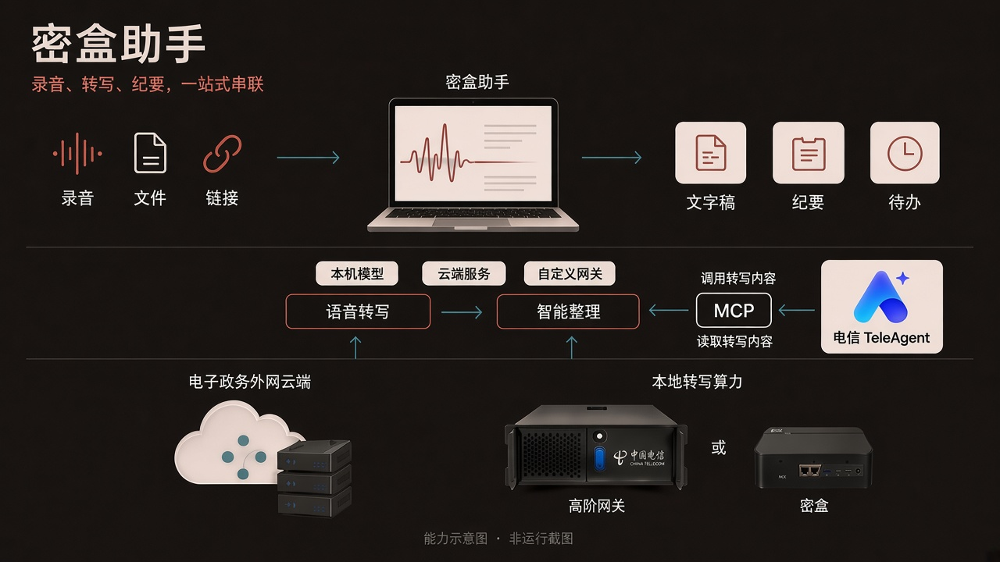

这是 AI 生成的能力示意图，采用上下分层，不是运行截图，图内已标注。副标题是「录音、转写、纪要，一站式串联」，没有写哪个系统已经支持。上层是录音、文件、链接，以及文字稿、纪要、待办；中层是转写和整理；下层把转写算力画成电子政务外网云端，或本地的高阶网关与约电视盒子大小的密盒。这些连线是可选配置示意，不是已验证的网络部署，也不含带宽或认证数据。软件里对应的是自填的 OpenAI 兼容地址，不绑定机型，也不是录音豆 D3200。电信 TeleAgent 单独画在一旁，通过 MCP 读取转写内容；它不提供转写算力，MCP 也不是 TeleAgent 的品牌名。

## 宣传片

预览版，部分过渡画面仍待更新。下面的动图只是新片开头约 2.5 秒的缩略，点它或下面的链接才会打开完整 MP4。页面不会自动播放。

[](docs/media/mibox-assistant-promo.mp4)

[播放完整视频（MP4，1280×720，约 102 秒）](docs/media/mibox-assistant-promo.mp4)

它是上游 [豆仓 BeanPod](https://github.com/andyhuo520/beanpod) 的衍生版，保留原项目致谢和 [MIT](LICENSE) 许可。相对上游，这份源码增加了本机转写模型选择（含 FunASR）、高阶网关，以及把口播视频工程交给 TeleAgent。上游的 DMG（v0.1.0、v0.1.1）不包含这些改动。本 fork 目前没有 GitHub Release。

三个名字不要混：

| 说法 | 指什么 |
|---|---|
| 密盒助手 | 这个 Mac App。英文界面对应 *Mi Box Assistant* |
| 录音来源里的「密盒」 | 界面把 Anker soundcore 录音豆（型号 D3200）显示为「密盒」。通信仍是录音豆协议 |
| 图中的本地「密盒」 | 首页示意图里的方形小盒，表示一种本地推理硬件。软件没有为某一机型写专用驱动 |
| 图中的「高阶网关」 | 首页示意图里的机架设备，同样是本地算力的一种示意，不是已验证的部署 |
| 设置里的「高阶网关/密盒」 | 自填的 OpenAI 兼容 HTTP 地址，用来转写或整理。它不限定机型，也不是 D3200 本身 |

`project.yml` 里 Mac 目标的营销版本是 **0.1.9（build 10）**。这是仓库源码上的版本号，不是你电脑里已经安装的那个 App。已安装的密盒助手以 App 内显示的版本为准。

非官方项目，与设备厂商及其合作方无关，只用于管理你自己设备上的录音。产品名和商标归各自所有者。若内容侵犯权益，请到上游 [Issues](https://github.com/andyhuo520/beanpod/issues) 说明；本 fork 的 Issues 是关闭的。

## 定位

给这些人用：想在 Mac 上整理会议、访谈、播客和自己录音的人；已经有 D3200 的人；希望 Claude、Codex、OpenClaw、TeleAgent 或只认网址的助手读取本机录音库的人。没有录音豆时，仍可用 Mac 录音、导入文件或粘贴链接。

iPhone 工程在 `Mobile/`，仍是试验。手机上没有本机大模型，也没有高阶网关这一档。

## 功能

「源码状态」只说明仓库里有没有这条路径。除宣传片文件元数据、链接可访问性和脚本语法外，下表各项都没有在本次文档改写里重新跑过设备或界面。

| 能力 | 源码状态 | 数据去向 |
|---|---|---|
| 连接 D3200：电量、存储、固件、电脑上开始/暂停/结束、按键录音跟随、重点标记 | 已实现。协议笔记的设备核对写的是固件 04.92 | 录音下载到本机后解密为 `.ogg` |
| 连上后自动下载未同步录音 | 已实现，可关 | 本机库 |
| Wi‑Fi 快传 | 已实现。笔记里有一次约 500 KB/s、电脑离开原 Wi‑Fi 约 40 秒的记录，不是稳定指标 | 经录音豆热点传到本机，期间这台 Mac 会离开原来的网络 |
| 得到 AI 录音卡 GSC10 | 按公开协议实现，仓库写明未实机测试。不能从电脑开录，无 Wi‑Fi 快传 | 下载进同一录音库 |
| Mac 录音 | 已实现：麦克风、系统声音，或两路一起 | 本机 |
| 导入音频、视频、文字；粘贴播客/视频链接 | 已实现。链接导入会向对应网站下载 | 下载结果留在本机。只应用于你有权使用的公开内容 |
| 视频画面 | 已实现。默认约 5 分钟以内保留最高 720p，更长的默认只留声音 | 画面文件在本机 |
| 本机转写 | 可选 Qwen3-ASR 0.6B、Gemma 4 E2B BF16、FunASR Paraformer Q8、Fun-ASR-Nano-2512 | 计算在本机。见下面的回退说明 |
| 系统语音识别 | 已实现。用途文案写的是在本机完成 | 本次未单独验证 Apple 语音识别是否联网 |
| 云端转写 | 可选。预设含小米 MiMo、硅基流动、OpenAI、Groq，也可填兼容 `/audio/transcriptions` 的地址 | **音频会发到你填写的服务** |
| 高阶网关转写 | 可选。自填 http(s) 地址、模型名和可选密钥 | **音频会发到该地址**，地址可以在局域网，也可以在公网 |
| 实时字幕 | 录音舞台已实现，且要求本机转写模型已经就绪 | 走当前本机转写 |
| 整理纪要 | 十种场景，生成标题、摘要、分栏、待办、人物、标签。职业是固定列表 | 取决于整理模式，见下一节 |
| 改写 | 口播稿、短视频脚本、长帖、公众号、会后邮件、拆解写法、仿写、自定义 | 使用当前整理模型，长稿可能被分段后送入该模型 |
| 英语学习模式 | 英文为主的录音可勾选。产出 CEFR、词汇、短语和难句；不勾则是普通纪要 | 使用整理模型 |
| 知识库、项目、标签、导出 Markdown / M4A / WAV | 已实现 | 问答会把摘录发给当前整理模型。导出写到你选的位置 |
| 最近删除 | 本机删除保留 7 天。从设备上删除不经过这里 | 本机 |
| 语音输入 | 已实现，默认关闭。必须连着设备，触发键是键盘修饰键 | 识别走本机转写模型。原声默认留 30 天 |
| 飞书妙记 | 已实现。自动同步时间隔 30 分钟 | 用你授权的 `lark-cli` 从飞书拉回 |
| MCP / 命令行 | 六个工具，stdio，以及只监听 `127.0.0.1:8791` 的 HTTP | 本机。助手拿到文字之后如何处理，由那个助手决定 |
| 数字人口播 | 已实现为 TeleAgent 交接，不在密盒助手里直接生成 | 确认后的生成发生在 Renoise。示例主播首次使用会把照片上传到你的 Renoise 账号 |
| iPhone | `Mobile/` 试验，不在 Mac 安装包路径里 | 转写只有云端和系统识别 |

本机转写的回退：默认引擎是「本机模型」。Qwen 或 Gemma 还没下载好时，转写这一步会改用系统语音识别。Paraformer 和 Fun-ASR-Nano 缺权重或随包运行程序时会报错，不会悄悄改道。设置里对「本机且已就绪」写了录音不上传；这句话只描述这一档转写，不包括云端、网关和整理。

## 快速开始

需要一台 **macOS 26** 的 Mac。`project.yml` 的部署目标是 macOS 26.0。Apple 芯片更适合本机模型。随 App 打包的 FunASR 运行程序是 **macOS arm64**（见 `ThirdParty/FunASR/PROVENANCE.md`），Intel 上不能把这个文件当成可用的转写程序。

本 fork 没有可下载的安装包。请用当前仓库源码构建。不要用上游 `BeanPod-0.1.x.dmg` 代替本版。

写这一节时，命令只对照了仓库文件：Homebrew 配方 `xcodegen`、`llama.cpp`、`ffmpeg`、`yt-dlp` 在 formulae.brew.sh 上可查；两个 Python 脚本通过了语法检查。当时的环境是 Linux，没有 Swift、Xcode 或 XcodeGen，**没有编译，没有执行 `swift test`，没有打开 App，也没有连接设备。** 因此下面不是实测通过的安装记录。

### 从源码构建

准备带 macOS 26 SDK 的 Xcode，以及 [Homebrew](https://brew.sh)。部署目标需要该 SDK；本次没有在 Mac 上核对具体的 Xcode 版本号。

```bash
brew install xcodegen llama.cpp ffmpeg
```

导入链接时另需 `brew install yt-dlp`。小红书、抖音、视频号的下载器在第一次使用时由 App 装进独立 Python 环境，本次未跑这条路径。

```bash
xcodegen generate
xcodebuild -project BeanPod.xcodeproj -scheme BeanPod -derivedDataPath build build \
  CODE_SIGN_IDENTITY="Apple Development" CODE_SIGN_STYLE=Automatic DEVELOPMENT_TEAM=<你的团队号>
cp -R build/Build/Products/Debug/BeanPod.app /Applications/
open /Applications/BeanPod.app
```

产物名是 `BeanPod.app`，显示名是「密盒助手」。建议用自己的 Apple 开发证书签名，免费 Apple ID 也可以，团队号在 Xcode → Settings → Accounts。不签名时，每次重新编译后系统都可能重新询问蓝牙权限。请从「应用程序」或访达打开，不要在终端里直接运行包内的可执行文件。

第一次打开会走上手引导。App 会把命令行工具装到 `~/.local/bin/beanpod`。没有 `llama-server` 时，可在「设置 → 模型」里安装，App 查找的路径包括 `/opt/homebrew/bin/llama-server`。

核心协议库测试（需要本机有 Swift 工具链；本次未运行）：

```bash
swift test
```

`Tests/BeanKitTests/BeanKitTests.swift` 有 22 个测试，覆盖帧、加解密、Ogg、链接和字幕。没有 App 界面、流水线或 MCP 的测试。

### 示例数据

想看库的形状又不想动自己的录音时，在 macOS 上：

```bash
python3 scripts/make-demo-library.py
open -a BeanPod --args -demo
```

脚本用系统 `say` 和 `ffmpeg` 在 `~/Library/Application Support/BeanPod/Demo/Recordings/` 生成虚构内容。`-demo` 只读这套库：不连蓝牙、不开 MCP、不同步飞书。本次没有生成示例库。退出后正常打开，回到自己的录音库。

## 架构与实现

上面的首页图只表示能力关系。下面两张图按源码里的模块来画：来源进本机库，转写和整理走你选中的后端，MCP 只读本机库或把新内容放进 Inbox。虚线是未实机测试，或必须由你确认后才继续的步骤。

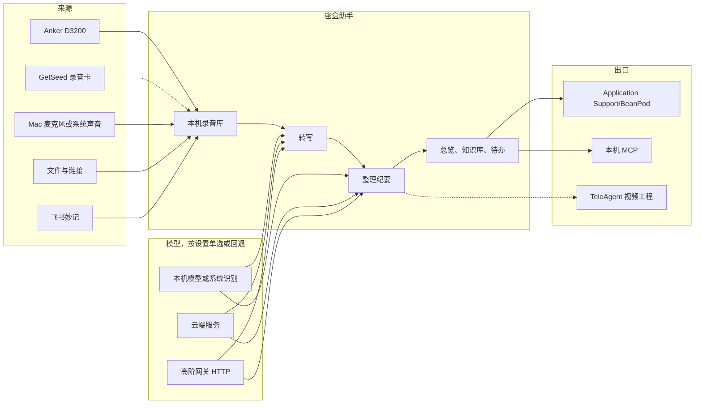

处理一条已入库录音时，顺序在 `Shared/Pipeline.swift` 的 `process` / `run`：

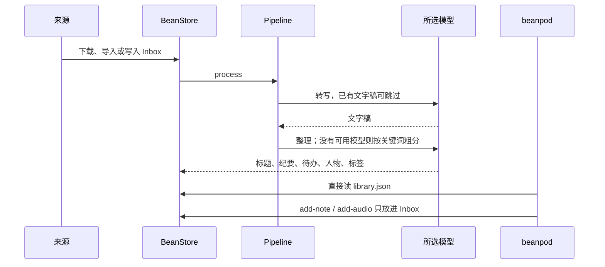

| 路径 | 作用 |
|---|---|
| `Sources/BeanKit/` | 录音豆与录音卡的帧、命令、解密、Ogg。不依赖界面 |
| `Shared/BeanStore.swift` | 录音库。普通模式在 `~/Library/Application Support/BeanPod/Recordings/` |
| `Shared/Pipeline.swift` | 转写、整理、收件箱、安装 CLI、拉起本机 MCP |
| `Shared/Settings.swift` | 引擎、整理模式、高阶网关地址。云端密钥进系统钥匙串 |
| `Shared/Analyzer.swift` | 纪要、改写、问答。本机长稿改写会先分段摘录 |
| `App/QwenASR.swift`、`App/LocalLLM.swift` | 用本机 `llama-server` 跑 Qwen / Gemma |
| `App/FunASR.swift`、`ThirdParty/FunASR/` | Paraformer 与 Fun-ASR-Nano 的 arm64 助手 |
| `Sources/beanpod/main.swift` | CLI 与 MCP。MCP 自报版本是 `0.2.0`，和 App 的 0.1.9 不是同一个字段 |
| `App/Connect.swift`、`App/TeleAgentConfig.swift` | 一键连接各助手 |
| `App/VideoMaker.swift` | 写视频工程并打开 TeleAgent |
| `Mobile/` | iPhone 试验界面 |
| `docs/PROTOCOL.md`、`docs/GETSEED.md` | 协议笔记与出处 |
| `docs/media/` | 上游宣传片，原文件保留 |
| `docs/assets/` | 首页能力示意图；`docs/assets/screenshots/` 是本机功能实拍 |
| `docs/screenshots/` | 上游示例图仍在目录里，README 不再用它们做功能展示 |

运行日志：`~/Library/Logs/BeanPod.log`。

协议笔记里的「实测」是上游作者在自己设备上的记录，本次文档改写没有复测。仓库不含厂商固件、密钥或反编译代码。

## 配置与用法

### 转写和整理

转写在「设置 → 模型」选择，四选一：

| 引擎 | 何时使用 | 是否把音频送出这台 Mac |
|---|---|---|
| 本机模型 | 默认。权重约：Qwen3-ASR 1 GB，Gemma 4 E2B 连投影约 10.3 GB，Paraformer Q8 237 MB，Fun-ASR-Nano 两个文件约 1.27 GB | 不送出。Qwen/Gemma 未就绪时会改用系统识别 |
| 系统语音识别 | 可显式选择，也会在上面的回退里用到 | 工程文案写本机完成；本次未验证 Apple 的网络行为 |
| 云端 | 填写兼容接口，或对单条使用「交给云端重转」 | 会送出 |
| 高阶网关 | 填写无用户名、无 query 的 http(s) URL 和模型名 | 会送到该 URL |

整理模式：

| 模式 | 行为 |
|---|---|
| 云端优先，连不上时用本机 | 默认。已经填写云端时，**文字稿会先发给云端**，失败再试本机模型 |
| 只用云端 | 只发到 `llmBaseURL` |
| 只用本机 | 用已下载的 Qwen3-4B（约 2.5 GB）或 Gemma。不向云端预设发送 |
| 高阶网关 | 只发到整理服务那一个 URL，不按上面的顺序回退 |

云端整理预设写在 `AppSettings.presets`：小米 MiMo、DeepSeek、通义千问、Kimi、豆包、智谱 GLM、MiniMax、硅基流动、OpenRouter、Gemini、Claude、OpenAI，以及本机 Ollama（`127.0.0.1:11434`）和 LM Studio（`127.0.0.1:1234`）。Ollama / LM Studio 的地址在本机时，文字稿不出这台电脑；其余预设会出网。密钥存在钥匙串。

没配好任何整理模型时，流水线按关键词做粗分类，不生成完整纪要。

界面语言：跟随系统，或在「设置 → 通用」里固定简体中文 / English。纪要语言单独设置。字符串在 `App/Localizable.xcstrings`。添加语言可用 `python3 scripts/i18n-sync.py`，本次只检查了脚本语法。

### 权限

| 权限 | 作用 | 不开时 |
|---|---|---|
| 蓝牙 | 连接 D3200 和录音卡 | 只能 Mac 录音或导入 |
| 麦克风 | Mac 录音；语音输入不用这台 Mac 的麦 | 不能用 Mac 麦录音 |
| 屏幕与系统录音 | 录电脑里的声音 | 只能录麦克风 |
| 辅助功能 | 听住快捷键，把语音输入打进其他 App | 语音输入不可用 |
| 通知 | App 不在前台时提示同步和整理完成 | 只在窗口内提示 |
| 本地网络 | 访问你填写的局域网地址 | 高阶网关若在局域网则连不上 |

### 飞书妙记

手机上的官方 App 若先连上设备，录音可能进入飞书妙记并从设备消失。拉回步骤以源码里的提示为准：安装 [@larksuite/cli](https://registry.npmjs.org/@larksuite/cli)（`npm install -g @larksuite/cli`），然后 `lark-cli config init --new` 和 `lark-cli auth login --domain minutes`。原说明还要求导出音频时开通 `minutes:minutes.media:export` 并重新登录该 scope；不开时只拉文字稿。本次没有重新做飞书授权。

### MCP

App 开着且不是 `-demo` 时，会启动 `beanpod serve --port 8791`，只接受本机连接。`GET /health` 返回 `{"ok":true}`。

| 工具 | 作用 |
|---|---|
| `search_recordings` | 按关键词、时间、场景、人物、话题搜索 |
| `get_recording` | 一条录音的纪要，可选文字稿 |
| `list_todos` | 待办，默认未完成 |
| `list_topics` | 场景、话题、人物计数 |
| `add_note` | 把文字放进 Inbox，由开着的 App 导入 |
| `add_audio` | 把本机音频文件放进 Inbox |

一键连接会改这些位置：Claude Code 的用户级 MCP、Codex、OpenClaw、Claude 桌面版的 `claude_desktop_config.json`（先备份）、当前账号的 `~/.config/TeleAgent/users/<账号>/TeleAgent.jsonc`（先备份；含注释或格式不兼容则不改）。Grok Bot 等只认网址的工具填写 `http://127.0.0.1:8791/mcp`，App 关掉后地址不通。

```bash
beanpod search 预算 --from 7d --scene 会议
beanpod show <id> --transcript
beanpod todos
beanpod topics
beanpod add-note 标题 < 文本
beanpod add-audio <文件>
beanpod mcp
beanpod serve --port 8791
```

日期可以是 `YYYY-MM-DD`、`today`、`yesterday`、`7d`。场景名用中文，如「会议」。

手动配置：

```json
{
  "mcpServers": {
    "beanpod": {
      "command": "/Users/<你的用户名>/.local/bin/beanpod",
      "args": ["mcp"]
    }
  }
}
```

通过 OpenClaw 的微信插件在微信里查询，是 OpenClaw 的能力。先在本 App 连上 OpenClaw，再按其文档配置，本次未连接。

### 做成视频

在改写结果上点「做成视频」后，`VideoMaker` 准备工程目录和 `TASK.md`，并打开 TeleAgent。需要你在 TeleAgent 新建会话、选中该目录、粘贴任务再发送。报价和扣积分发生在 TeleAgent / Renoise 会话里，密盒助手不代你确认。

按钮的帮助文字仍写着交给 Claude 桌面版。当前实现打开的是 TeleAgent，以 `App/VideoMaker.swift` 为准。

Renoise 的 MCP 地址是 `https://renoise.ai/api/public/mcp`。本次只确认该网址可访问，没有登录，也没有提交任务。主播资料在 `~/Library/Application Support/BeanPod/Hosts/`。从本 App 移除主播不会删除 Renoise 账号里的素材。

### 数据放在哪，什么时候会离开 Mac

录音、文字稿和纪要的库在 `~/Library/Application Support/BeanPod/`。本应用没有自己的上传服务器。

会离开这台 Mac 的情况只有这些：你打开了云端转写、云端整理或高阶网关；整理模式是默认的「云端优先」并且已经填了云端；你导入链接时向网站下载；你用飞书命令行读取妙记；你在 TeleAgent / Renoise 里确认了视频任务；你把 MCP 结果交给一个自己会外发的助手。只选本机转写和「只用本机」整理、且不使用上面这些路径时，音频和文字稿发给的是本机进程。

## 界面

下面是用户 Mac 上密盒助手的实拍，界面为中文，图里没有版本号。总览顶条、连接卡片、模型设置、MCP、空链接框和知识库入口里，有一部分是此前已经拍过并做过安全裁切的素材，不是这 11 张都在同一轮新拍。没有完整总览，也没有飞书同步列表。

### 录音整理

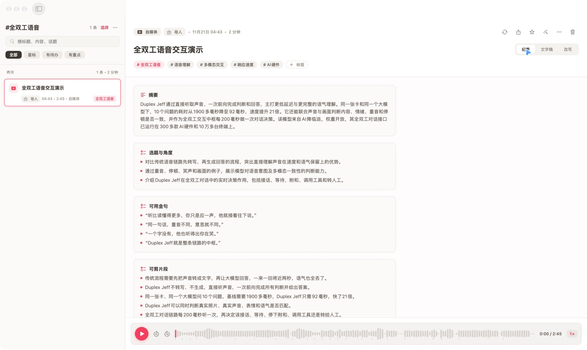

演示标签下的录音列表和纪要。Duplex Jeff 的台词和性能数字是演示录音内容，不是本项目的测试结果。


文字稿顶部的局部裁切，不是整窗。图中的台词和性能数字同样是演示录音内容，不是本项目指标。

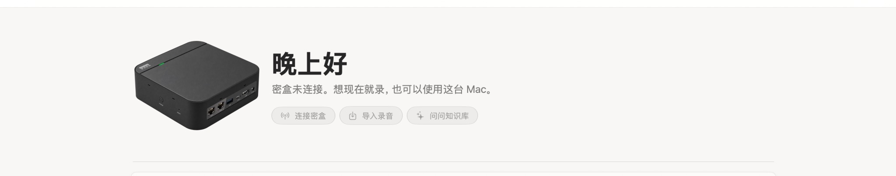

总览安全顶区，不是完整总览。

### 输入与知识检索

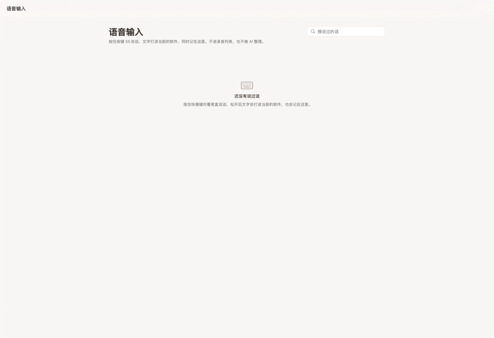

语音输入是空的，没有历史。这张图不展示打字结果。

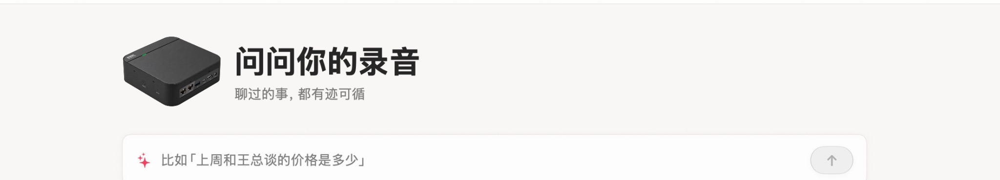

知识库的空搜索入口，不是一次问答的结果。


链接框是空的，不表示已经导入。

### 设置与恢复

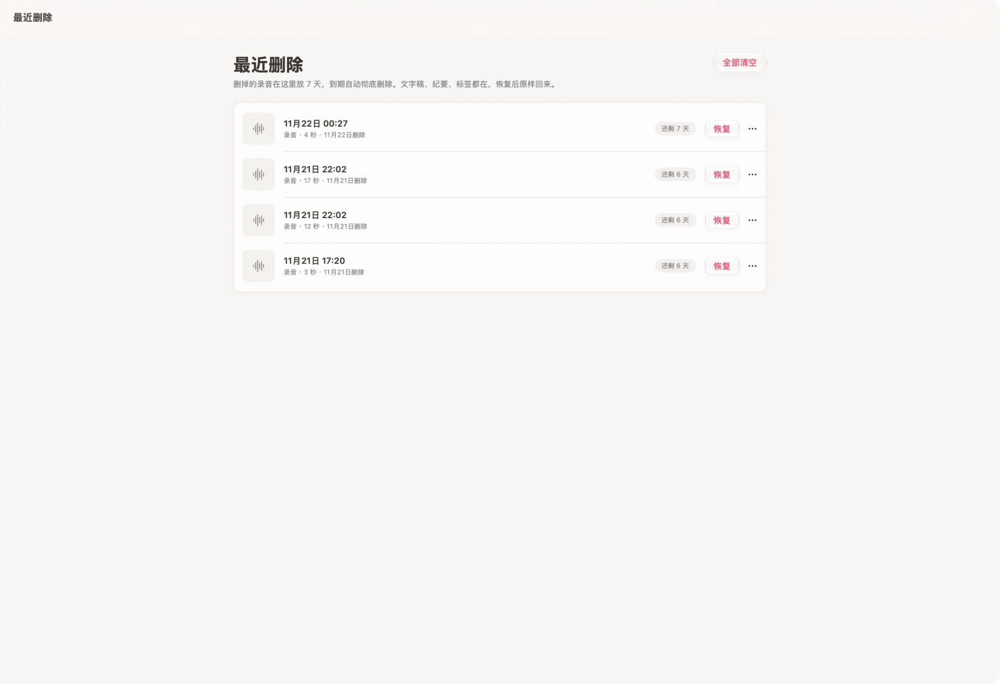

最近删除里只见日期标题，页面上有恢复入口。

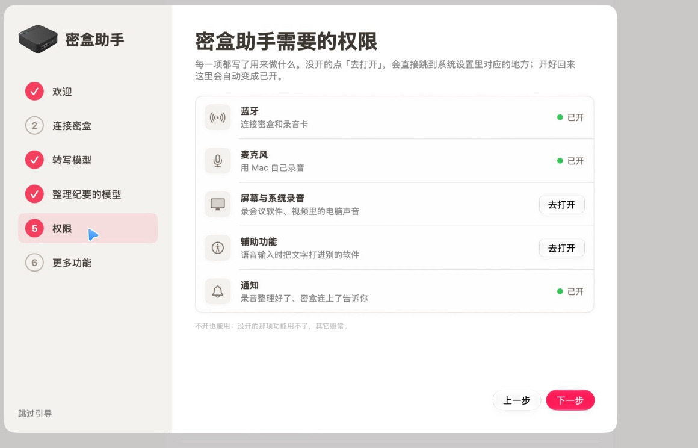

上手引导里的权限卡片。图中开关是拍摄时的系统状态。


连接密盒的步骤和「开始搜索」。这是入口，图里没有已连接状态，也没有飞书列表。

<table>
<tr>
<td width="50%">

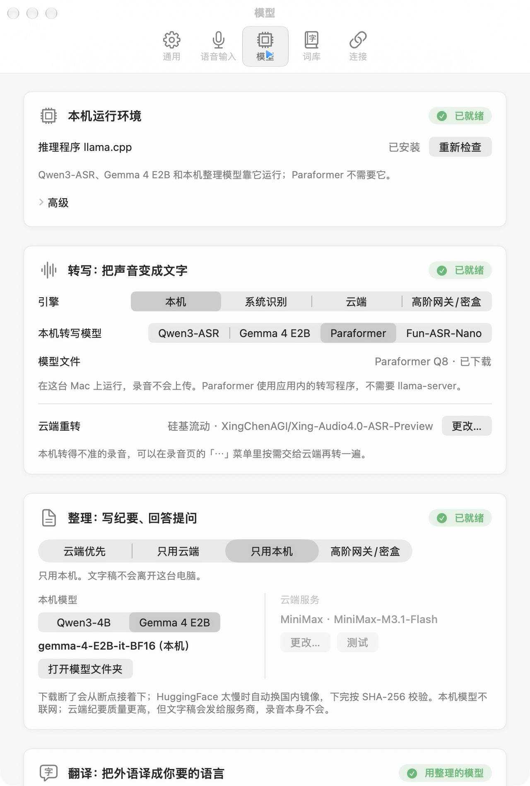

模型设置是截图当时的选择，不是出厂默认。

</td>
<td width="50%">

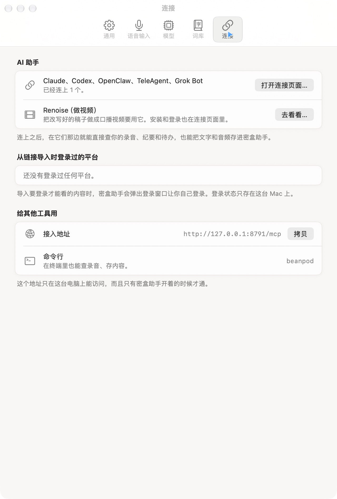

连接页里的 MCP 设置。

</td>
</tr>
</table>

## 常见问题

**电脑里已经装了密盒助手，是不是就是 0.1.9？**  
不一定。0.1.9 只写在这份源码的工程设置里。请看 App 自己的版本。两套文件不要互相覆盖，除非你知道自己在替换哪一个构建。

**是不是录音永远不离开本机？**  
不是。库在本机，但云端、高阶网关、默认的「云端优先」整理、链接下载、飞书和视频交接都会发生网络访问。见上一节的表。

**没有录音豆能用吗？**  
可以。Mac 录音、导入和链接不依赖设备。语音输入不行：代码要求设备已连接，并且只监听键盘修饰键，没有鼠标按键，也不改用 Mac 麦克风。

**为什么搜不到设备？**  
录音豆同一时间只连一台主机。手机连着时，先关掉手机蓝牙。协议笔记写明只在固件 04.92 上核对过，全新、未在官方 App 开通的设备能否直接连接，笔记标为未知。

**得到录音卡能用吗？**  
源码有实现，文档写明还没有实机测试。

**刘海快捷面板会挡住菜单栏吗？**  
无刘海时，窗口顶边仍按屏幕 `frame` 的顶边放置，因此仍可能挡住菜单栏图标。本次没有在显示器上查看。上游 [issue #4](https://github.com/andyhuo520/beanpod/issues/4) 仍开放，那份避让修改不在本仓库。

**还有哪些请求没有做成？**  
自定义职业名称和整理提示词仍未做，职业是固定枚举。更多云端 ASR 品牌不会自动出现，除非它兼容现有接口并由你填入。阶跃星辰没有单独预设。

## 贡献与许可

协议起步于 [tacshi/Soundcore](https://github.com/tacshi/Soundcore)。得到录音卡的协议事实来自 [Shawn-TKD/getseed-ble-protocol](https://github.com/Shawn-TKD/getseed-ble-protocol)（MIT，Copyright (c) 2026 Shawn-TKD）。本仓库按文档用 Swift 另写，声明见 [NOTICE](NOTICE)。FunASR 运行程序的来源和校验写在 `ThirdParty/FunASR/PROVENANCE.md`。

本仓库许可是 [MIT](LICENSE)，Copyright (c) 2026 berryxia。

本 fork 没有打开 Issues。豆仓原项目的问题和讨论在 [andyhuo520/beanpod](https://github.com/andyhuo520/beanpod/issues)。针对密盒助手源码的修改，请向本仓库提交 Pull Request。欢迎的改动应和现有行为一致：不要把未实机测试写成已测试，也不要承诺录音在所有设置下都不出本机。
